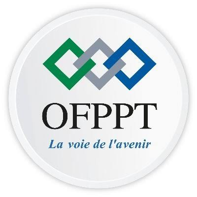

# Découvrir les Labs
## et la stack technique

### Projet technique : gestion des domaines professionnels

**Étudiant :** Mohamed Dghar 
**Encadrant :** ESSARRAJ FOUAD

---

## Projet technique

Une application web pour **centraliser les domaines professionnels** liés aux offres d'emploi.

| Fonctionnalité | État actuel |
|---|---|
| Consulter la liste des domaines | Disponible |
| Ajouter un domaine (nom et description) | Disponible |
| Modifier ou supprimer un domaine | À développer |
| Gérer les offres d'emploi | À développer |

L'interface communique avec une API PHP ; les domaines sont conservés dans un fichier JSON.

---

## Stack technique

| Technologie | Utilisation dans le projet |
|---|---|
| HTML5 | Structure de l'interface |
| Tailwind CSS | Mise en forme de la page |
| JavaScript (`fetch`) | Appels asynchrones à l'API |
| PHP orienté objet | API et logique métier |
| JSON | Stockage des domaines |

**Parcours des données :** interface web → API PHP (`GET` / `POST`) → fichier JSON.

---

<!-- _class: compact -->

## Comprendre les Labs

**C'est quoi ?** Un exercice court pour découvrir un outil et l'essayer sur un cas concret.

**Pourquoi ?**

- Apprendre en pratiquant et tester une solution à petite échelle.
- Identifier les avantages et les limites d'un outil.
- Réutiliser les acquis dans le projet technique.

**Lien avec le projet :** chaque Lab développe une compétence utile pour concevoir, coder, tester ou livrer.

---

<!-- _class: compact -->

## Liste des Labs à réaliser

| Catégorie | Labs |
|---|---|
| Outils et développement | Markdown · Git et GitHub · GitHub Pages · Issues et Actions · Antigravity · Marp · OpenCode · Pandoc · OmniRoute · MCP · Laravel |
| Conception et organisation | Design Thinking · UX Design · Figma · 2TUP · Scrum |
| Pratique du projet | Prompt · Starter Lab · Erreur-JS · Découverte des Labs et de la stack |

*Liste de départ : consulter le document de suivi pour l'ordre et l'avancement.*
