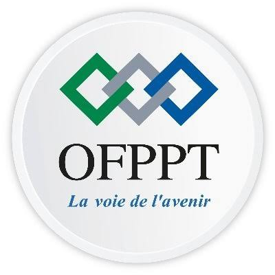

<!-- _class: title -->

# lab-php

## Gestion des erreurs, namespaces et traits

**Présenté par :** Dghar Mohamed  
**Encadrant :** ES-SARRAJ Fouad

---

<!-- _class: light -->

## Plan de Présentation

1. Introduction & Stack Technique
2. Définitions
3. Problème
4. Solution

---

## Introduction & Stack Technique

- Présenter l'objectif du lab et son lien avec le projet technique.
- Lister les technologies, outils et versions réellement utilisés.
- Expliquer brièvement le rôle de chaque composant.

---

<!-- _class: light -->

## Définitions

- **Erreurs et exceptions :** détection et traitement des situations anormales en PHP.
- **Namespace :** organisation des classes et prévention des conflits de noms.
- **Trait :** réutilisation de méthodes dans plusieurs classes.

---

<!-- _class: problem -->

## Problème

- À compléter à partir de la réponse de l'étudiant : quel problème concret motive ce lab ?
- Préciser le contexte et les conséquences constatées.
- Ne pas présenter d'exemple comme un problème vécu sans confirmation.

---

<!-- _class: solution -->

## Solution et mise en pratique

- Présenter la démarche proposée par l'étudiant, après l'avoir recueillie.
- Prévoir un Quick Start et un premier exemple PHP exécutable.
- Montrer un exercice sur les erreurs et exceptions, un sur les namespaces et un sur les traits, liés au projet.
- Terminer par l'intégration et la vérification des exemples.

---

<!-- _class: solution -->

## Démonstrations et livrables

- Exemples PHP à compléter selon l'environnement réel du projet.
- Résultats des vérifications à présenter après exécution.
- Dernière diapositive : solution ou livrable, sans conclusion ni remerciements.
